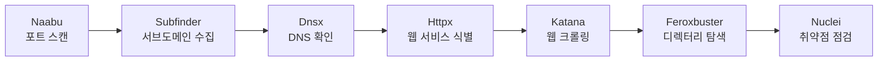

<div align="center">

# DiscoveryX

**흩어진 보안 도구를 하나의 워크플로우로.**

도메인 탐색부터 웹 취약점 점검까지, Go로 만든 보안 정보 수집 CLI.


[빠른 시작](#빠른-시작) · [사용 예제](#사용-예제) · [설정](#설정) · [사용 가이드](docs/usage.md)

</div>

---

보안 진단을 시작할 때마다 도구를 설치하고, 결과 파일을 정리하고, 다음 도구에 입력을 넘기는 일을 반복하게 됩니다. DiscoveryX는 이 과정을 한 번의 실행으로 이어 줍니다. 중간에 실패한 단계는 이유를 남기고, 이미 확보한 결과로 진행할 수 있는 작업은 계속합니다.

스캔은 검증된 오픈소스 도구가 맡습니다. DiscoveryX는 실행 순서와 탐색 범위, 부하, 버전, 결과를 관리합니다. Windows를 우선 지원하며, Linux는 현재 교차 빌드까지 확인했습니다.

## 어떤 작업을 하나요?



각 단계는 순차적으로 실행합니다. 포트 스캔을 마지막으로 옮기거나, 처음과 마지막에 나눠 실행할 수도 있습니다.

- **필요한 단계만 선택합니다.** 수집 단계를 건너뛰거나 웹 점검만 실행할 수 있습니다.
- **범위를 지킵니다.** 입력한 도메인과 하위 도메인을 다음 단계로 넘기고, 외부 링크와 CNAME은 별도로 기록합니다.
- **원본을 남깁니다.** 도구별 출력과 정규화한 결과를 따로 보관해 탐지 근거를 확인할 수 있습니다.
- **중단한 작업을 이어 갑니다.** 재개할 때 완료 상태와 파일 해시를 함께 확인합니다.
- **업데이트 시점을 직접 정합니다.** 실행 파일과 Nuclei 템플릿을 구분해 관리하며 일반 스캔 중에는 갱신하지 않습니다.

## 빠른 시작

Go 1.25 이상이 필요합니다. PowerShell에서 저장소를 내려받고 빌드하세요.

```powershell
git clone https://github.com/naroSEC/DiscoveryX.git
cd DiscoveryX
go build -o discoveryx.exe ./cmd/discoveryx
```

도구를 미리 설치하고 실행 환경을 확인할 수 있습니다. 설치하지 않고 스캔을 시작해도 필요한 도구는 해당 단계에서 자동으로 설치됩니다.

```powershell
.\discoveryx.exe tools install
.\discoveryx.exe doctor
```

디렉터리 탐색에 사용할 사전은 `wordlists/common.txt`에 직접 넣어 주세요. 다른 사전은 `--wordlist`로 지정할 수 있습니다. Nuclei 템플릿은 별도 명령으로 설치합니다.

```powershell
.\discoveryx.exe templates update
```

준비가 끝났다면 대상 도메인으로 실행하세요. 기본 설정으로 모든 단계를 순서대로 진행합니다.

```powershell
.\discoveryx.exe -u example.com
```

> [!NOTE]
> 사전이나 템플릿이 없으면 해당 단계는 이유를 기록하고 건너뜁니다. 파일을 임의로 내려받거나 점검을 마친 것으로 표시하지 않습니다.

## 사용 예제

### 기본 실행과 단계 선택

```powershell
# 기본 순서로 실행
.\discoveryx.exe -u example.com

# 포트 스캔과 크롤링 제외
.\discoveryx.exe -u example.com -ps off -cwl off

# Subfinder를 제외하고 원본 도메인의 DNS·웹 서비스부터 확인
.\discoveryx.exe -u example.com -ps off -sbf off
```

`-sbf`, `-cwl`, `--dir`, `--nuc`는 `on/off`로 설정합니다. `-ps`는 `first`, `last`, `both`, `off`를 지원합니다. 긴 옵션인 `--subfinder`, `--crawl`, `--port-scan`도 사용할 수 있습니다.

### 포트 스캔을 마지막에 실행

```powershell
.\discoveryx.exe -u example.com -ps last
```

`-ps both`를 사용하면 최초에는 원본 도메인, 마지막에는 새로 발견한 호스트의 IP를 확인합니다. 동일 조건으로 완료한 IP는 중복 스캔하지 않습니다. 대상 호스트의 DNS 결과를 사용합니다.

### 이미 알고 있는 웹 서비스만 점검

```powershell
.\discoveryx.exe -u https://example.com/app --web-only
```

Naabu·Subfinder·Dnsx를 건너뛰고 **Httpx → Katana → Feroxbuster → Nuclei** 순서로 진행합니다. Httpx가 수집한 기술 스택은 디렉터리 탐색 확장자에도 반영됩니다.

입력 URL의 스킴·포트·경로·쿼리는 유지합니다. 도메인만 입력하면 HTTPS를 먼저 확인한 뒤 필요할 때 HTTP를 확인합니다. Httpx가 실패해도 원래 URL로 나머지 웹 단계를 진행합니다.

### 중단한 작업 재개

```powershell
.\discoveryx.exe resume --run "runs\example.com_기존실행시각"
```

기존 실행 디렉터리를 지정하면 검증된 완료 단계는 재사용합니다. 실패하거나 출력이 손상된 단계부터 다시 실행하며, 이전 원본 파일도 보존합니다.

## 설정

기본값은 [`configs/config.yaml`](configs/config.yaml)에 있습니다. 설정 파일의 값을 CLI로 덮어쓰거나 `DISCOVERYX_` 환경 변수를 사용할 수 있습니다.

```text
CLI > 환경 변수 > config.yaml > 기본값
```

```powershell
.\discoveryx.exe -u example.com -ps off `
  --wordlist "C:\진단 자료\common.txt" `
  --output "C:\진단 결과" `
  --katana-rate 10 --katana-concurrency 2 `
  --crawl-depth 3 --max-targets 50 --max-duration 1h
```

속도와 동시성은 도구별로 조정할 수 있습니다. 디렉터리 탐색 확장자는 Httpx의 기술 탐지 결과와 [기술 매핑 규칙](configs/tech-extensions.yaml)을 조합해 정합니다. 예를 들어 PHP가 탐지되면 기본 확장자에 `php`를 추가하고, IIS만 탐지된 경우에는 ASP.NET으로 단정하지 않습니다.

전체 옵션은 `discoveryx.exe --help`, 세부 동작은 [사용 가이드](docs/usage.md)에서 확인할 수 있습니다.

## 도구와 템플릿 관리

```powershell
.\discoveryx.exe tools list
.\discoveryx.exe tools update
.\discoveryx.exe tools update --tool naabu

.\discoveryx.exe templates version
.\discoveryx.exe templates update
```

외부 도구는 공식 GitHub Releases의 OS·아키텍처별 바이너리로 설치합니다. 체크섬이 있으면 검증하고, 새 실행 파일의 버전과 동작을 확인한 뒤 설치 정보를 전환합니다. 검증에 실패하면 기존 버전을 유지합니다.

`tools update`는 실행 파일만, `templates update`는 Nuclei 템플릿만 갱신합니다. 스캔 중에 도구 자체 업데이트를 실행하지 않으며, 사용 중인 설치 경로의 업데이트도 잠금으로 막습니다.

## 결과 확인

실행마다 독립된 디렉터리가 생깁니다. 콘솔에는 발견 건수와 실패·건너뜀 사유를 표시하고, 상세 결과는 파일로 남깁니다.

```text
runs/<호스트>_<실행시각>/
├── metadata.json     # 대상, 설정, 도구 버전
├── status.json       # 단계별 상태와 무결성 정보
├── inputs/           # 정제한 호스트와 웹 URL, 입력 스냅샷
├── raw/              # 도구별 원본 결과와 프로세스 로그
├── normalized/       # 자산, 포트, 웹 서비스, URL, 탐지 이벤트
├── logs/             # 실행 로그와 오류
└── summary.json      # 통합 요약
```

Nuclei 탐지는 검토가 필요한 점검 결과입니다. 중복 이벤트는 표시하되 원본을 삭제하지 않아, 템플릿과 탐지 근거를 다시 확인할 수 있습니다.

## 현재 지원 범위

Windows 빌드, 공식 도구 7개의 설치·버전 확인, 모의 스캐너 기반 자동화 테스트를 확인했습니다. 실제 Httpx·Katana·Feroxbuster도 루프백 서버에서 테스트했습니다.

현재 알아둘 제약은 다음과 같습니다.

- **Naabu 2.6.1:** `-sV-probes`를 지원하지 않아 서비스 버전 탐지는 경고 후 비활성화합니다. 일반 포트 스캔은 계속합니다.
- **Nuclei:** 고정 경로의 서명된 HTTP GET/HEAD 템플릿으로 점검 범위를 제한합니다. 코드 실행, OAST, 공격적인 퍼징 등은 활성화하지 않습니다.
- **Linux:** 교차 빌드는 확인했지만 실제 스캐너 실행과 권한 처리는 추가 검증이 필요합니다.

도구 옵션은 설치된 바이너리의 도움말로 다시 확인합니다. 필요한 기능이 없으면 임의의 인자로 대체하지 않고 이유를 출력합니다. 버전별 차이와 미검증 항목은 [호환성 기록](docs/compatibility.md)과 [테스트 기록](docs/testing.md)에 정리했습니다.

## 개발 및 테스트

```powershell
go test ./... -count=1
go vet ./...
go build -o discoveryx.exe ./cmd/discoveryx
```

기본 테스트는 모의 실행 파일과 로컬 HTTP 서버를 사용하며 외부 도메인을 스캔하지 않습니다. 어댑터, 실행 엔진, 설치 관리자, 범위 검사, 파서와 저장소는 `internal/` 아래에 나누어 두었습니다. 새 도구를 추가하는 방법과 구조는 [사용 가이드](docs/usage.md#구조와-확장)를 참고하세요.
