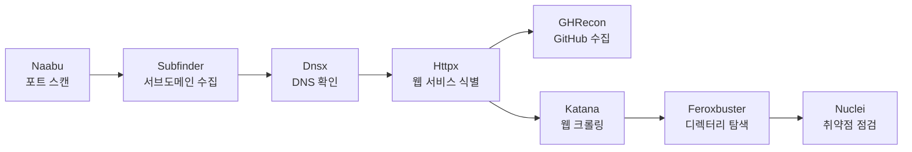

<div align="center">

# DiscoveryX

**흩어진 보안 도구를 하나의 워크플로우로.**

도메인 탐색부터 웹 취약점 점검까지, Go로 만든 보안 정보 수집 CLI.


[빠른 시작](#빠른-시작) · [사용 예제](#사용-예제) · [설정](#설정) · [사용 가이드](docs/usage.md)

</div>

---

보안 진단을 시작할 때마다 도구를 설치하고, 결과 파일을 정리하고, 다음 도구에 입력을 넘기는 일을 반복하게 됩니다. DiscoveryX는 이 과정을 한 번의 실행으로 이어 줍니다. 중간에 실패한 단계는 이유를 남기고, 이미 확보한 결과로 진행할 수 있는 작업은 계속합니다.

스캔은 검증된 오픈소스 도구가 맡습니다. DiscoveryX는 실행 순서와 탐색 범위, 부하, 버전, 결과를 관리합니다. Windows를 우선 지원하며, Linux는 현재 교차 빌드까지 확인했습니다.

## 어떤 작업을 하나요?



기존 웹 점검 단계는 순차적으로 실행합니다. GitHub 토큰이 있으면 Httpx 이후 GHRecon을 별도 작업으로 시작해 Katana → Feroxbuster → Nuclei 흐름과 병행합니다. 포트 스캔을 마지막으로 옮기거나, 처음과 마지막에 나눠 실행할 수도 있습니다.

- **GitHub에서도 단서를 찾습니다.** GHRecon이 찾은 저장소·도메인·URL·클라우드 자산을 출처와 함께 HTML에서 확인합니다.
- **필요한 단계만 선택합니다.** 수집 단계를 건너뛰거나 웹 점검만 실행할 수 있습니다.
- **범위를 지킵니다.** 입력한 도메인과 하위 도메인을 다음 단계로 넘기고, 외부 링크와 CNAME은 별도로 기록합니다.
- **원본을 남깁니다.** 도구별 출력과 정규화한 결과를 따로 보관해 탐지 근거를 확인할 수 있습니다.
- **결과를 한눈에 봅니다.** HTML 리포트에서 자산과 탐지 결과를 구분해 살펴보고, 사용한 명령어까지 확인할 수 있습니다.
- **중단한 작업을 이어 갑니다.** 재개할 때 완료 상태와 파일 해시를 함께 확인합니다.
- **업데이트 시점을 직접 정합니다.** 실행 파일과 Nuclei 템플릿을 구분해 관리하며 일반 스캔 중에는 갱신하지 않습니다.

## 빠른 시작

Go 1.25 이상이 설치되어 있다면 다음 명령으로 설치할 수 있습니다.

```powershell
go install github.com/naroSEC/DiscoveryX/cmd/discoveryx@latest
discoveryx --help
```

기본 설정과 기술별 확장자 룰, 디렉터리 탐색 사전은 실행 파일에 포함되어 있어, 저장소를 따로 내려받지 않아도 됩니다. 직접 작성한 설정은 `--config`, 기술 매핑은 `--tech-rules`로 지정할 수 있습니다.

<details>
<summary>설치 후 discoveryx 명령을 찾지 못한다면</summary>

Go의 실행 파일 설치 폴더가 PATH에 있는지 확인해 주세요. `GOBIN`을 지정하지 않았다면 기본 경로는 `$(go env GOPATH)\bin`입니다. 현재 PowerShell 세션에는 다음처럼 추가할 수 있습니다.

```powershell
$goBin = go env GOBIN
if (-not $goBin) { $goBin = Join-Path (go env GOPATH) "bin" }
$env:Path += ";$goBin"
discoveryx --help
```

</details>

<details>
<summary>소스에서 직접 빌드하기</summary>

```powershell
git clone https://github.com/naroSEC/DiscoveryX.git
cd DiscoveryX
go build -o discoveryx.exe ./cmd/discoveryx
.\discoveryx.exe --help
```

직접 빌드했다면 아래 예제의 `discoveryx`를 `.\discoveryx.exe`로 바꿔 실행하세요.

</details>

도구를 미리 설치하고 실행 환경을 확인할 수 있습니다. 설치하지 않고 스캔을 시작해도 필요한 도구는 해당 단계에서 자동으로 설치됩니다.

```powershell
discoveryx tools install
discoveryx doctor
```

기본 디렉터리 탐색 사전인 [`wordlists/common.txt`](wordlists/common.txt)는 실행 파일에 내장되어 있습니다. 별도 사전을 지정하지 않으면 어디에서 실행하든 내장 사전을 사용합니다. `go install`로 설치해도 별도의 사전 파일이 필요하지 않습니다. 다른 사전은 `--wordlist <경로>`로 지정하세요. Nuclei 템플릿은 첫 점검에서 관리 폴더가 비어 있으면 자동 설치합니다. 첫 설치에는 다운로드와 인덱스 생성 시간이 필요합니다. 미리 설치하거나 이후에 갱신하려면 다음 명령을 사용하세요.

```powershell
discoveryx templates update
```

준비가 끝났다면 대상 도메인으로 실행하세요. 기본 설정으로 모든 단계를 순서대로 진행합니다.

```powershell
discoveryx -u example.com
```

> [!NOTE]
> 별도 사전을 지정하지 않으면 내장된 기본 사전으로 디렉터리 탐색을 수행합니다. `--wordlist <경로>` 또는 설정 파일에 외부 사전 경로를 지정했는데 해당 파일을 찾거나 읽을 수 없는 경우에만 사전 오류로 디렉터리 탐색을 건너뜁니다.
>
> Nuclei 템플릿의 최초 설치가 실패하면 원인과 재시도 명령을 표시하고 해당 단계를 실패로 남깁니다. `--template-auto-install=false`로 자동 최초 설치를 끌 수 있습니다.

## 사용 예제

### 기본 실행과 단계 선택

```powershell
# 기본 순서로 실행
discoveryx -u example.com

# 포트 스캔과 크롤링 제외
discoveryx -u example.com -ps off -cwl off

# Subfinder를 제외하고 원본 도메인의 DNS·웹 서비스부터 확인
discoveryx -u example.com -ps off -sbf off
```

`-sbf`, `-cwl`, `--dir`, `--nuc`는 `on/off`로 설정합니다. `-ps`는 `first`, `last`, `both`, `off`를 지원합니다. 긴 옵션인 `--subfinder`, `--crawl`, `--port-scan`도 사용할 수 있습니다.

일반 모드에서는 URL이나 서브도메인을 입력해도 루트 도메인을 기준으로 수집합니다. `https://www.example.com/app`을 입력하면 Subfinder에는 `-d example.com`을 전달하고, 초기 Naabu는 `example.com`의 DNS 조회 결과로 얻은 IP 목록을 `-list`로 전달받습니다. `api.example.co.kr`은 `example.co.kr`로 구분하며, IP 주소와 단일 호스트 이름은 그대로 사용합니다. 입력한 호스트도 DNS·웹 서비스 탐색 대상에 포함하고, 원래 입력값은 `metadata.json`의 `original_target`에 보관합니다. `--web-only`에서는 루트 도메인으로 변경하지 않고 입력 URL을 유지합니다.

### 포트 스캔을 마지막에 실행

```powershell
discoveryx -u example.com -ps last
```

`-ps both`를 사용하면 최초에는 루트 도메인, 마지막에는 새로 발견한 호스트의 IP를 확인합니다. 동일 조건으로 완료한 IP는 중복 스캔하지 않습니다. 대상 호스트의 DNS 결과를 사용합니다.

### 이미 알고 있는 웹 서비스만 점검

```powershell
discoveryx -u https://example.com/app --web-only
```

Naabu·Subfinder·Dnsx를 건너뛰고 **Httpx → Katana → Feroxbuster → Nuclei** 순서로 진행합니다. Httpx가 수집한 기술 스택은 디렉터리 탐색 확장자에도 반영됩니다.

입력 URL의 스킴·포트·경로·쿼리는 유지합니다. 도메인만 입력하면 HTTPS를 먼저 확인한 뒤 필요할 때 HTTP를 확인합니다. Httpx가 실패해도 원래 URL로 나머지 웹 단계를 진행합니다.

### GitHub 수집 함께 실행

토큰을 전달하면 기본 `ghrecon: auto` 설정에서 GitHub 수집을 함께 실행합니다. `https://www.example.com`을 입력하면 GHRecon에는 `--domain example.com`을 전달합니다. `api.example.co.kr`처럼 접미사가 여러 단계인 도메인도 구분합니다.

```powershell
discoveryx -u https://www.example.com --github-token "github_pat_..."

# 토큰 파일 사용
discoveryx -u https://www.example.com --github-token-file "C:\보안 설정\github.token"

# GitHub 수집 제외
discoveryx -u https://www.example.com --ghrecon off
```

`DISCOVERYX_GITHUB_TOKEN` 또는 `GITHUB_TOKEN` 환경 변수도 사용할 수 있습니다. 직접 입력한 토큰은 쉘 이력에 남을 수 있으므로 평소에는 토큰 파일이나 환경 변수를 권장합니다. DiscoveryX는 토큰을 GHRecon의 환경 변수로 전달하고, 저장하는 설정·명령어·로그·HTML에서는 값을 제외하거나 마스킹합니다.

GHRecon은 Httpx 뒤에 시작하며, 기존 웹 점검이 끝나도 GitHub 수집이 진행 중이면 완료를 기다린 뒤 최종 요약을 만듭니다. 토큰이 없으면 기본적으로 기존 워크플로우만 실행합니다. `--ghrecon on`으로 명시했는데 토큰이 없으면 해당 단계의 사유를 표시합니다. Web-only 모드에서도 같은 방식으로 동작합니다.

결과는 HTML의 **GitHub 수집** 화면에서 유형별로 구분하고, 저장소·파일 경로·검색어·원본 링크를 상세 보기로 확인할 수 있습니다. GitHub에서 발견한 주소는 웹 스캐너 입력으로 자동 추가하지 않습니다.

### 중단한 작업 재개

```powershell
discoveryx resume --run "runs\example.com_기존실행시각"
```

기존 실행 디렉터리를 지정하면 검증된 완료 단계는 재사용합니다. 실패하거나 출력이 손상된 단계부터 다시 실행하며, 이전 원본 파일도 보존합니다.

## 설정

기본값은 [`configs/config.yaml`](configs/config.yaml)에 있습니다. 설정 파일의 값을 CLI로 덮어쓰거나 `DISCOVERYX_` 환경 변수를 사용할 수 있습니다.

```text
CLI > 환경 변수 > config.yaml > 기본값
```

```powershell
discoveryx -u example.com -ps off `
  --wordlist "C:\진단 자료\common.txt" `
  --output "C:\진단 결과" `
  --katana-rate 10 --katana-concurrency 2 `
  --crawl-depth 3 --max-targets 50 --max-duration 1h
```

Feroxbuster와 Nuclei는 기본적으로 **설치된 도구의 속도·동시성 기본값**을 사용합니다. Feroxbuster의 `--rate-limit`, `-t`, `--scan-limit`과 Nuclei의 `-rl`, `-c`, `-bs`를 강제로 지정하지 않습니다. 필요하면 `--feroxbuster-rate`, `--feroxbuster-concurrency`, `--feroxbuster-scan-limit`, `--nuclei-rate`, `--nuclei-concurrency`로 조정하세요. 해당 설정의 `0`은 도구 기본값을 의미합니다.

이전 설정 파일을 유지하고 있다면 아래 값을 바꾸거나 CLI에서 `0`으로 덮어써야 합니다. 기존 파일의 명시적인 제한은 그대로 적용됩니다.

```yaml
feroxbuster_scan_limit: 0
template_auto_install: true
limits:
  # 다른 도구 항목은 기존 설정 유지
  feroxbuster: {rate: 0, concurrency: 0}
  nuclei: {rate: 0, concurrency: 0}
```

단계별 시간 제한은 기본 30분, 전체 실행 시간은 2시간입니다. 큰 사전을 사용해 시간이 더 필요하다면 `--stage-timeout 2h --max-duration 4h`처럼 조정하세요.

속도와 동시성은 도구별로 조정할 수 있습니다. 디렉터리 탐색 확장자는 Httpx의 기술 탐지 결과와 [기술 매핑 규칙](configs/tech-extensions.yaml)을 조합해 정합니다. 예를 들어 PHP가 탐지되면 기본 확장자에 `php`를 추가하고, IIS만 탐지된 경우에는 ASP.NET으로 단정하지 않습니다.

기본 사전 설정은 `wordlist: builtin`입니다. 이전 설정 파일에 `wordlist: wordlists/common.txt`가 남아 있다면 `builtin`으로 바꾸거나 `--wordlist builtin`으로 내장 사전을 선택하세요.

전체 옵션은 `discoveryx.exe --help`, 세부 동작은 [사용 가이드](docs/usage.md)에서 확인할 수 있습니다.

## 도구와 템플릿 관리

```powershell
discoveryx tools list
discoveryx tools update
discoveryx tools update --tool naabu

discoveryx templates version
discoveryx templates update
```

외부 도구는 공식 GitHub Releases의 OS·아키텍처별 바이너리로 설치합니다. 체크섬이 있으면 검증하고, 새 실행 파일의 버전과 동작을 확인한 뒤 설치 정보를 전환합니다. 검증에 실패하면 기존 버전을 유지합니다.

`tools update`는 실행 파일만, `templates update`는 Nuclei 템플릿만 갱신합니다. 스캔 중에 도구 자체 업데이트를 실행하지 않으며, 사용 중인 설치 경로의 업데이트도 잠금으로 막습니다.

## 결과 확인

실행이 끝나면 결과 폴더의 **`report.html`을 브라우저로 열어 보세요.** 별도 서버나 인터넷 연결 없이 결과를 살펴볼 수 있습니다. 밝은 화면과 어두운 화면을 지원하고, 좁은 화면에서도 표를 가로로 넘겨 읽을 수 있습니다.

- **개요:** 주요 발견 건수, 심각도 분포, 단계별 진행 상태를 한 화면에 표시합니다.
- **결과 탐색:** 자산·포트·웹 서비스·URL·디렉터리·탐지 결과·GitHub 수집을 나눠 봅니다. 검색, 호스트·심각도 필터, 정렬과 페이지 이동을 지원합니다.
- **상세 확인:** 개별 레코드의 JSON과 원본 근거를 확인하고, 현재 필터에 맞는 결과를 JSON으로 내보낼 수 있습니다. 탐지 결과의 중복 표시도 전환할 수 있습니다.
- **명령어 기록:** DiscoveryX 실행 명령과 각 스캔 단계에서 호출한 도구의 경로·인자·실행 시간·상태를 표시합니다. 사전 점검과 템플릿 설치·목록 조회는 따로 구분하고, 명령어 복사와 stdout/stderr 로그 확인을 제공합니다.

이미 저장한 실행 결과에서도 리포트만 다시 만들 수 있습니다. 이 명령은 스캐너를 실행하지 않습니다.

```powershell
discoveryx report --run "runs\example.com_기존실행시각"
```

이전 버전의 결과에 명령어 기록이 없으면 해당 항목은 비어 있는 상태로 표시합니다. 당시 사용한 명령어를 추측해서 채우지 않습니다.

실행마다 독립된 디렉터리가 생깁니다. 콘솔에는 발견 건수와 실패·건너뜀 사유, HTML 리포트 경로를 표시합니다.

```text
runs/<호스트>_<실행시각>/
├── report.html       # 검색·필터·상세 보기를 제공하는 오프라인 리포트
├── metadata.json     # 대상, 설정, 도구 버전
├── status.json       # 단계별 상태와 무결성 정보
├── inputs/           # 정제한 호스트와 웹 URL, 입력 스냅샷
├── raw/              # 도구별 원본 결과와 프로세스 로그
├── normalized/       # 자산, 포트, 웹 서비스, URL, 탐지 이벤트
├── logs/             # 실행 로그, 오류, commands.json 명령어 기록
└── summary.json      # 통합 요약
```

Nuclei 탐지는 검토가 필요한 점검 결과입니다. 중복 이벤트는 표시하되 원본을 삭제하지 않아, 템플릿과 탐지 근거를 다시 확인할 수 있습니다.

## 현재 지원 범위

Windows 빌드, 공식 도구 8개의 설치·버전 확인, 모의 스캐너 기반 자동화 테스트를 확인했습니다. 실제 Httpx·Katana·Feroxbuster도 루프백 서버에서 테스트했습니다.

현재 알아둘 제약은 다음과 같습니다.

- **Naabu 2.6.1:** `-sV-probes`를 지원하지 않아 서비스 버전 탐지는 경고 후 비활성화합니다. 일반 포트 스캔은 계속합니다.
- **Nuclei:** 고정 경로의 서명된 HTTP GET/HEAD 템플릿으로 점검 범위를 제한합니다. 코드 실행, OAST, 공격적인 퍼징 등은 활성화하지 않습니다.
- **Linux:** 교차 빌드는 확인했지만 실제 스캐너 실행과 권한 처리는 추가 검증이 필요합니다.

도구 옵션은 설치된 바이너리의 도움말로 다시 확인합니다. 필요한 기능이 없으면 임의의 인자로 대체하지 않고 이유를 출력합니다. 버전별 차이와 미검증 항목은 [호환성 기록](docs/compatibility.md)과 [테스트 기록](docs/testing.md)에 정리했습니다.

## 개발 및 테스트

```powershell
go test ./... -count=1
go vet ./...
go build -o discoveryx.exe ./cmd/discoveryx
```

기본 테스트는 모의 실행 파일과 로컬 HTTP 서버를 사용하며 외부 도메인을 스캔하지 않습니다. 어댑터, 실행 엔진, 설치 관리자, 범위 검사, 파서와 저장소는 `internal/` 아래에 나누어 두었습니다. 새 도구를 추가하는 방법과 구조는 [사용 가이드](docs/usage.md#구조와-확장)를 참고하세요.
